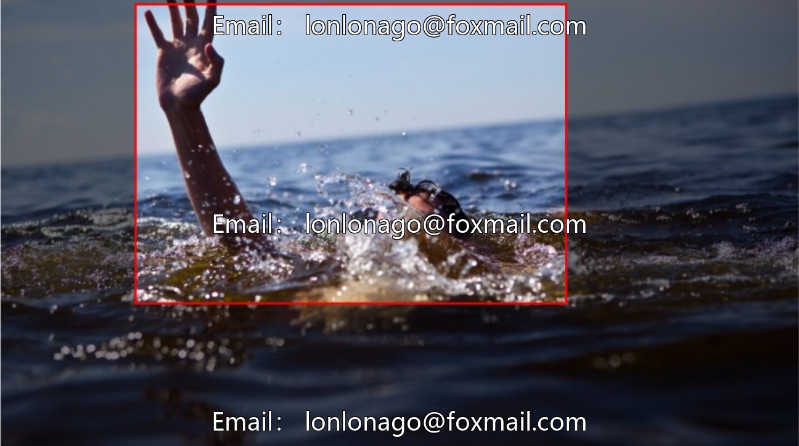
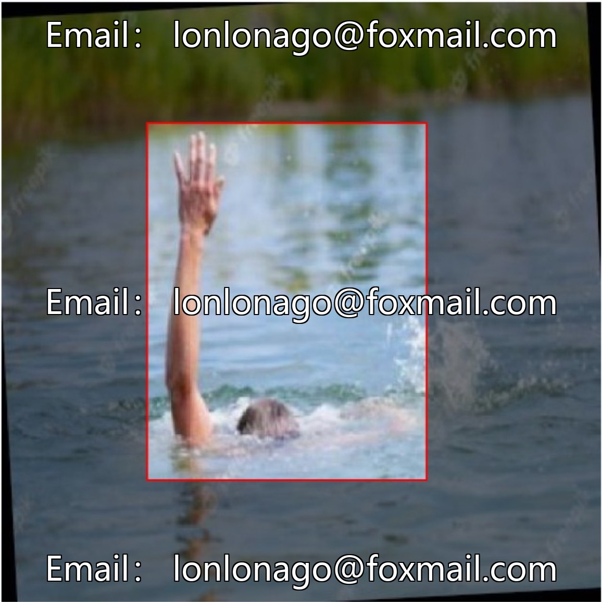
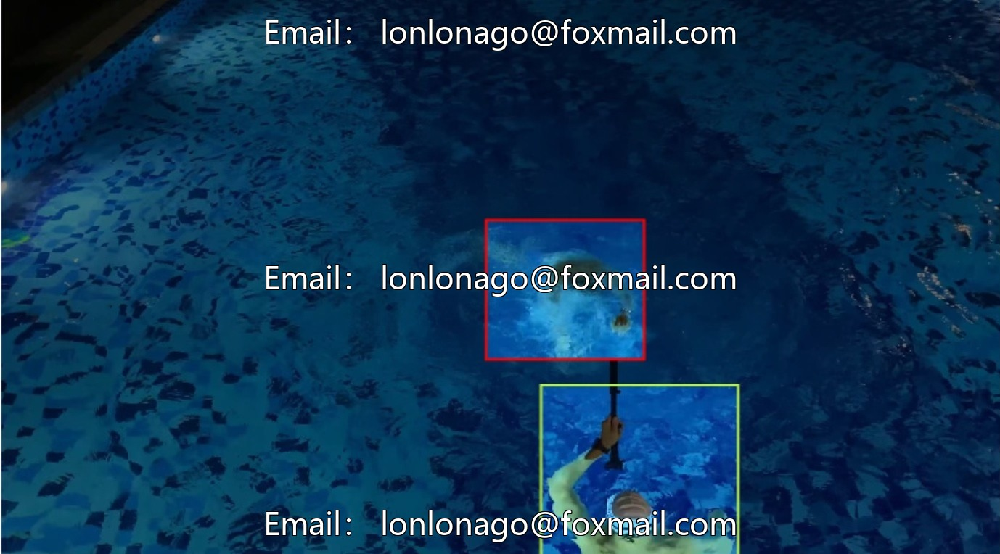
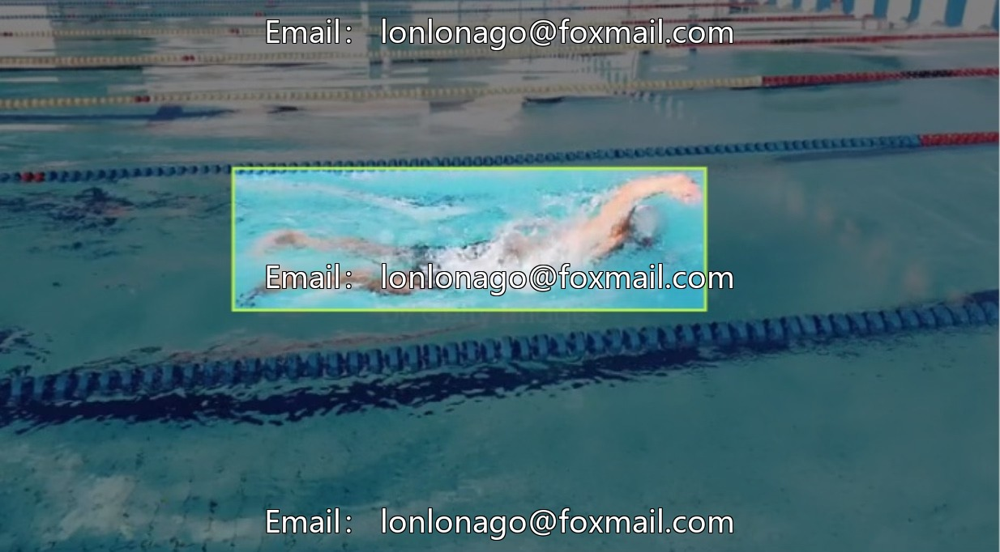
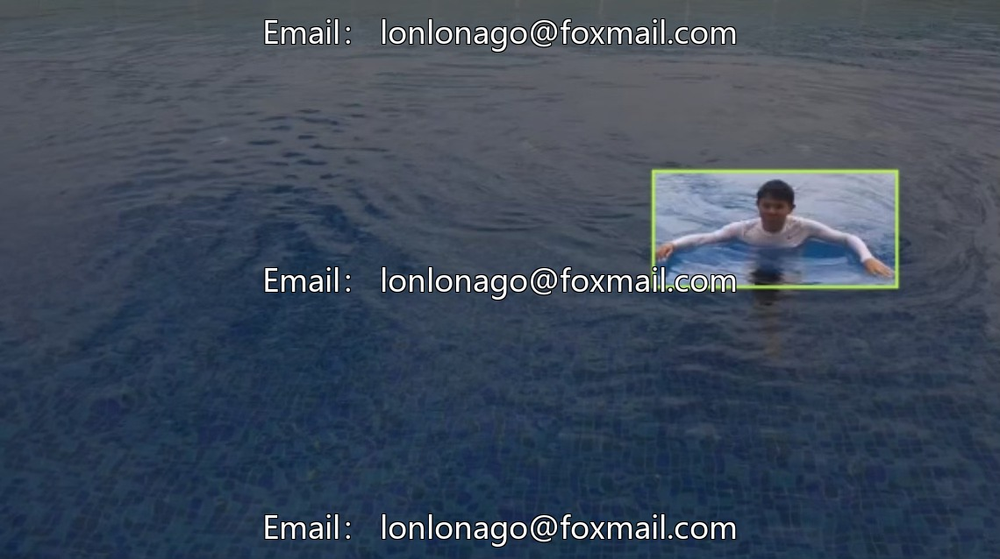

# Safety drowning identification dataset, deep learning target detection for drowning victims, YOLO algorithm

## Body

Safety drowning identification dataset, deep learning target detection for drowning victims, YOLO algorithm issue 10308

The dataset consists of 4315 images (4.3k images), with 2 categories: drowning and normal. The images cover scenes such as swimming pools, lakes, beaches, etc., and support the training of basic object detection models, meeting the needs of preliminary model verification and effect testing, and providing a basic framework for subsequent data expansion.

The data format is an image file, compatible with mainstream deep learning frameworks, and can be directly used as input for models. Resolution recommendations: it is recommended to first count the full image, clarify the distribution range, and then standardize the processing.

Virtual materials, once sold, are non-refundable.
Interested friends, click "I want" to proceed.

## Images

## Payment

Here is a pay link on Stripe ( https://buy.stripe.com/3cs8yP7sY87d0vu9AB ). Please contact me lonlonago@foxmail.com after funding $89, and I will send you a complete data files , thank you!

